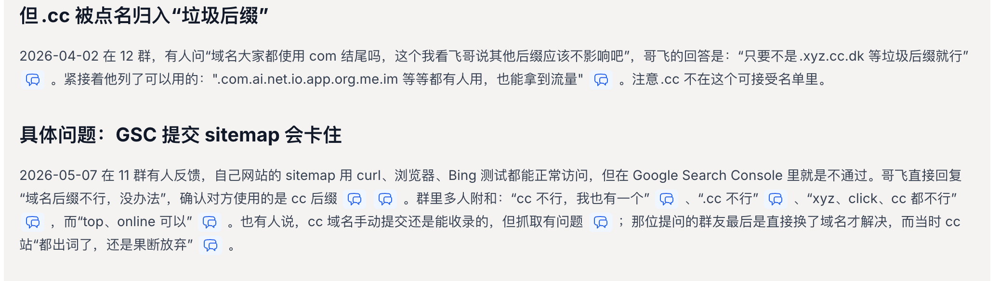
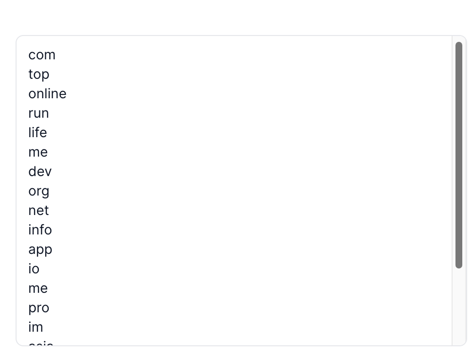

> 在线阅读（GitHub Pages）：https://maynor996.github.io/cc-domain-pitfall/

# 我上了 20 多个视频模板站几乎没收益，复盘下来：.cc 域名是个大坑

做新词新站的人，最爱干一件事：**便宜域名一口气囤一批，站先上了再说**。

我这边视频模板站，有一批就踩在 **.cc** 上。结果很扎心——**二十多个站挂上去，几乎没有像样的收益**；同时 Google Search Console 里 sitemap 提交、抓取也反复出问题。后来对照哥飞社区里的实践结论，才把「后缀随便挑」这件事彻底纠正过来。

这篇文章把踩坑过程、社区里的硬证据，以及现在怎么选后缀，一次性说清楚。**具体站名和完整域名一律不写**，只讲后缀与现象。

---

## 先把两件事拆开

很多人一听「.cc 不好」，就理解成「Google 算法专门惩罚 .cc」。

更准确的说法是：

1. **后缀本身对 SEO 的影响通常很小**——标题、内容、外链、产品本身，权重远高于后缀字母；  
2. **但某些便宜后缀在实操里会被点名避开**——不是玄学，而是 **GSC sitemap / 抓取、外链兼容、垃圾站密度** 这类可复现问题。

所以：**.cc ≠ 一定被算法封杀**；**.cc ≈ 新站抢速度时不该赌的那一类后缀**。

---

## 哥飞社区对后缀的总体判断

2023 年前后群里就有过讨论：后缀关系不大。到了 2026-10-15 那篇数据文，观点被量化了：2025.05–2026.08 共 14 届新词新站月赛前 20 名、278 个网站、37 种后缀——**「后缀的影响微乎其微，还不如好好写好网页标题」**；前 20 名里 `.com`、`.org`、`.net`、`.app`、`.ai`、`.io` 这 6 个主流后缀合计约占 **77%**。

原文：[域名后缀怎么选？14 届比赛前 20 名的数据告诉你](https://new.web.cafe/topic/axf2n642sy)

优先级很清楚：

> 有 `.com` 就用 `.com`；没有就 `.org` / `.net` / `.app`；别为了抢后缀耽误上站。

---

## 但 .cc 被明确点名：归入「垃圾后缀」那一拨

2026-04-02，有人问：是不是大家都用 `.com`，其他后缀有没有影响？

哥飞的回答很直：

> 只要不是 `.xyz`、`.cc`、`.dk` 等垃圾后缀就行。

紧接着列了可用方向：`.com`、`.ai`、`.net`、`.io`、`.app`、`.org`、`.me`、`.im` 等，都有人用、也能拿到流量。

**注意：.cc 不在可接受名单里。**

社区整理里也常把这段和后面的 GSC 问题放在一起看：

---

## 具体坑：GSC 提交 sitemap 会卡住

这是我自己感触最深的一层，也和群里多次踩坑高度重合。

2026-05-07，有人反馈：sitemap 用 curl、浏览器、Bing 都能正常打开，**唯独 Google Search Console 过不去**。哥飞直接回：

> 域名后缀不行，没办法。

对方确认用的就是 **.cc**。群里多人附和：「cc 不行，我也有一个」「xyz、click、cc 都不行」；也有人说手动提交偶尔能收首页，但抓取仍别扭。有人站都已经「出词」了，还是果断换域名。

我这边视频模板站批量用 `.cc` 时，表现高度类似：

- 站能打开、内容也做了；  
- **GSC 侧 sitemap / 抓取反复不顺**；  
- 二十多个站堆上去，**几乎看不到像样收益**。

当然，没收益不可能只怪后缀——产品、关键词、外链、页面质量都要背锅。但当「内容与提交动作都做了，GSC 却像堵墙」时，**.cc 会把问题放大成系统性卡点**，特别耽误新词站抢收录窗口。

---

## 还有一层：外链与老系统兼容性

2026-06-28 的经验帖提到：代提交外链时，很多老旧博客 / 论坛 / BBS **不认新兴后缀**——`.com`、`.net` 能正常解析成 `<a>`，而 `.ai`、`.gg`、`.app`、`.video` 一类经常解析失败（系统没升级）。

原文：[尽量不要注册个性域名后缀……](https://new.web.cafe/topic/girwjv2jl4)

`.cc` 属于同一类风险：你以为铺了外链，对方系统可能根本没给你链出去。对靠外链启动的站，这是隐性损耗。

---

## 别把 .online / .top 当「安全平替」

之前有人把 `.online`、`.top` 说成「可以」，出处其实是群友个人经验，不是哥飞结论。

同一篇 2026-10-15 数据文里，哥飞写明要避开太便宜的后缀：**.xyz、.top、.online、.site**（同类语境里 `.shop` 也常被点到）——垃圾站用得多，优化更难。

`.click` 更有实锤：2025-06 就有人强烈避雷——练手站 GSC sitemap 无法抓取、Bing 也难交内页；2026-05 讨论里又有人总结「xyz、click、cc 都不行」。

**省几块钱后缀费，换来收录窗口丢掉几天，对新词站往往更贵。**

---

## 我自己的复盘结论（视频模板站）

结合亲身批次 + 社区证据，我现在的纪律是：

| 场景 | 建议 |
| --- | --- |
| **新站选域名** | 直接跳过 `.cc`；优先 `.com` / `.org` / `.net` / `.app` / `.ai` / `.io` |
| **已经出词的老 .cc** | 可以继续跑数据，但别再加仓同后缀；卡 GSC 就评估迁域名成本 |
| **批量视频模板 / 新词站** | 后缀统一走主流；批量上站时后缀选错 = 批量踩同一坑 |
| **图便宜** | `.app` 常比 `.com` 友好；`.me` 群里也有人说能用。别为了再省一点滑向 `.cc` / `.xyz` / `.click` / `.online` |

四五十块买 `.com`，在 2026 年并不算贵；真要比价可以用 [namebeta.com](https://namebeta.com/)、[query.domains](https://query.domains/) 等，Spaceship / Namecheap 也常被提到——但那是另一篇文章的事。**后缀选错，比价再狠也救不了 GSC。**

---

---

## 选域名时：用 query.domains 一次看清可注册后缀

图便宜乱买 `.cc` 之前，先把候选词丢进 [query.domains](https://query.domains/)：可以**一次性查看**各后缀是否还能注册，以及常见后缀列表（`.com`、`.app`、`.io`、`.me`、`.org`、`.net` 等），比开十几家注册商挨个搜省事。

避开 `.cc` / `.xyz` / `.click` 这类高风险后缀时，用这个工具先把「还能注册什么」扫一遍，再决定下单哪家平台。

---

## 一句话总结

- 后缀不是 SEO 的决定因素，但 **`.cc` 在哥飞社区实践里被明确点名避开**。  
- 高频实操问题是：**GSC sitemap / 抓取卡住**，外链老系统也不友好。  
- 我这边 **20+ 个视频模板站几乎没收益**，复盘里 `.cc` 是重要原因之一（不是唯一原因）。  
- **新站别赌 .cc**；已经出词的再看数据决定迁不迁。

如果你也在批量上站，先检查后缀有没有掉进 `.cc` / `.xyz` / `.click` / `.online` 这类名单——站可以再做一个，**收录窗口错过了就回不来**。

---

### 参考

1. [域名后缀怎么选？14 届比赛前 20 名的数据告诉你](https://new.web.cafe/topic/axf2n642sy)  
2. [外链经验：尽量不要注册个性域名后缀](https://new.web.cafe/topic/girwjv2jl4)  
3. 哥飞社区群聊实践整理（2026-04-02 / 2026-05-07 等关于垃圾后缀与 GSC 的讨论）